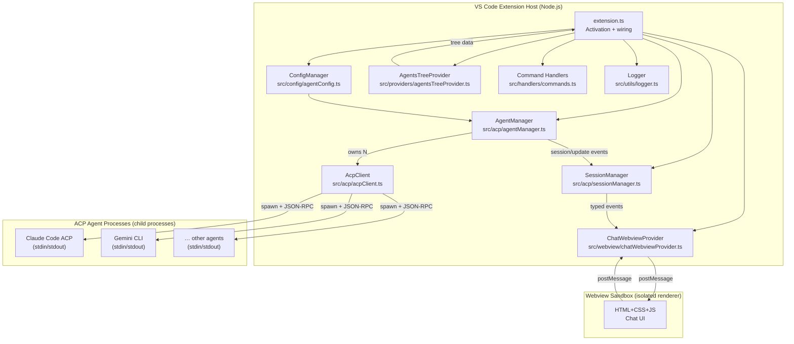
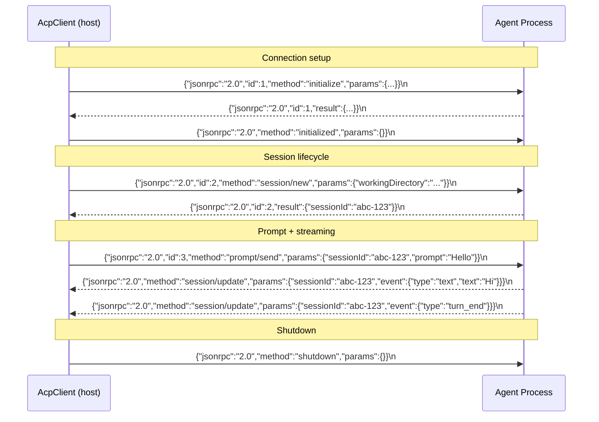
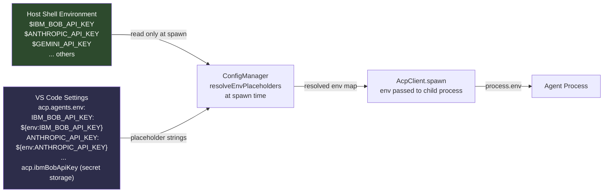
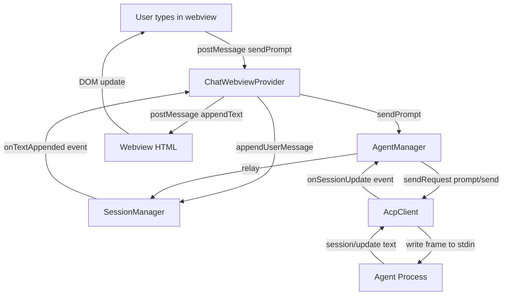

# Architecture — ACP for VSCode

This document describes the complete technical architecture of the ACP for VSCode extension.

---

## High-Level Component Map



---

## Transport Layer: JSON-RPC 2.0 over stdio

The ACP protocol uses **newline-delimited JSON** (NDJSON) over the agent process's stdin/stdout pipes.

```
Extension Host stdin  ──► Agent process stdout
Extension Host stdout ◄── Agent process stdin
```

Each JSON object is followed by a single `\n` character. The `AcpClient` class maintains a rolling string buffer and splits on newlines to extract complete frames.

### Message Flow



---

## Module Responsibilities

### `src/extension.ts`
- Extension entry point called by VS Code on activation.
- Instantiates all singletons in dependency order.
- Registers all context subscriptions for automatic disposal.

### `src/config/agentConfig.ts` — `ConfigManager`
- Reads `acp.*` settings from `vscode.workspace.getConfiguration`.
- Merges built-in agent presets with user-defined agents.
- Resolves `${env:VAR_NAME}` placeholders at spawn time (never at storage time).

### `src/acp/acpClient.ts` — `AcpClient`
- Manages **one** agent subprocess.
- Sends JSON-RPC requests and tracks pending Promises by id.
- Parses NDJSON from stdout; dispatches responses/notifications.
- Fires typed VS Code events: `onSessionUpdate`, `onStateChange`, `onExit`.

### `src/acp/agentManager.ts` — `AgentManager`
- Owns a `Map<name, AcpClient>`.
- Coordinates connect/disconnect/restart across multiple agents.
- Routes `session/update` notifications to `SessionManager`.
- Exposes session operations (`newSession`, `sendPrompt`, `cancelTurn`).

### `src/acp/sessionManager.ts` — `SessionManager`
- Maintains in-memory `AgentSession` objects (messages, tool calls, thinking).
- Applies incremental `session/update` events to session state.
- Handles permission requests: auto-approve or show VS Code modal.
- Fires typed events that `ChatWebviewProvider` relays to the webview.

### `src/providers/agentsTreeProvider.ts` — `AgentsTreeProvider`
- Implements `vscode.TreeDataProvider` for the Agents sidebar.
- Renders agent nodes (with connection state icons) and their session children.
- Refreshes on connection state changes and session creation events.

### `src/webview/chatWebviewProvider.ts` — `ChatWebviewProvider`
- Manages a single `vscode.WebviewPanel`.
- Contains the full self-contained HTML/CSS/JS chat UI (no external assets).
- Bridges extension host ↔ webview via `postMessage` / `onDidReceiveMessage`.
- Enforces a strict CSP with a per-render nonce.

### `src/handlers/commands.ts`
- Registers all 11 `acp.*` VS Code commands.
- Thin adapter: reads intent (from args or QuickPick), delegates to managers.

### `src/utils/logger.ts` — `Logger`
- Singleton with two output channels: `ACP Client` and `ACP Traffic`.
- Supports level filtering (`DEBUG/INFO/WARN/ERROR`).
- Traffic logging toggle controlled by `acp.logTraffic` setting.

---

## Security Model



**Key guarantees:**
- No secrets stored in VS Code settings — only `${env:VAR_NAME}` placeholder strings.
- IBM Bob API keys additionally supported via VS Code secret storage (`acp.ibmBobApiKey`), which uses the OS keychain — not `settings.json`.
- No secrets logged — `Logger` never writes env values.
- No external network requests from the webview CSP.
- Agent processes are isolated child processes; they cannot access VS Code APIs.

---

## Data Flow: User Sends a Message


