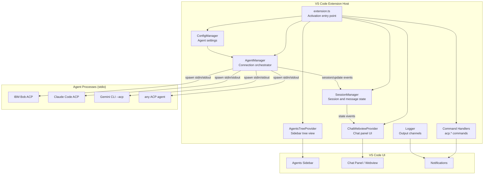
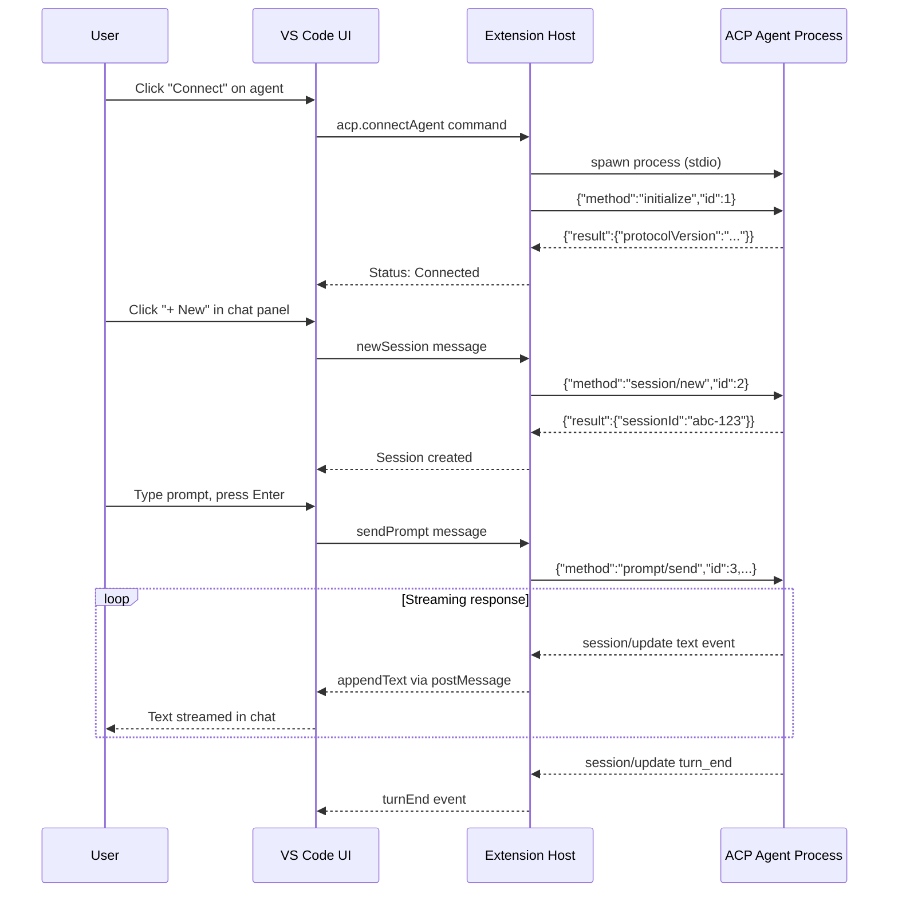

# ACP for VSCode

A production-ready **Agent Client Protocol (ACP)** integration for Visual Studio Code.  
Connect to any ACP-compatible AI coding agent — **IBM watsonx Code Assistant (IBM Bob)**, Claude Code, GitHub Copilot, Gemini CLI, Codex, OpenCode, Qwen Code, and more — directly from your editor using the open JSON-RPC 2.0 over stdio protocol.

> **Repository:** Update the `repository.url` field in `package.json` to your actual GitHub/GitLab URL before publishing to the VS Code Marketplace. The placeholder URL (`https://github.com/acp-vscode/acp-vscode`) is used for local builds only.

---

## Architecture



## Workflow



---

## Features

| Feature | Details |
|---|---|
| **IBM Bob (watsonx) support** | Built-in preset for IBM watsonx Code Assistant via ACP |
| **Multi-agent support** | 8 built-in presets + unlimited custom agents |
| **ACP protocol** | Full JSON-RPC 2.0 over stdio (newline-delimited) |
| **Streaming chat** | Real-time text, thinking blocks, tool calls |
| **Tool call display** | Collapsible tool call cards with input/output |
| **Permission management** | `ask` (modal) or `allowAll` auto-approve policy |
| **Session management** | Multiple sessions per agent, per-agent session list |
| **Protocol traffic log** | Raw JSON-RPC wire frames in a dedicated output channel |
| **Secure credential handling** | No hardcoded secrets — `${env:VAR_NAME}` placeholder resolution |
| **CSP-safe webview** | Nonce-based Content-Security-Policy; no external network calls |

---

## Requirements

- **VS Code** `1.85.0` or later
- **Node.js** `18.0.0` or later (for spawning agent processes via `npx`)
- At least one ACP-compatible agent installed and authenticated (see [IBM Bob Setup](#ibm-watsonx-code-assistant--ibm-bob-setup) or the Quickstart guide in `Docs/Quickstart.md`)

---

## IBM watsonx Code Assistant / IBM Bob Setup

IBM Bob (watsonx Code Assistant) supports ACP natively. To connect:

### 1. Obtain an API Key

Log in to IBM Cloud and create an API key at `https://cloud.ibm.com/iam/apikeys`.

### 2. Set the environment variable

Add to your shell profile (`~/.zshrc`, `~/.bashrc`, or `~/.profile`):

```bash
export IBM_BOB_API_KEY=your-ibm-cloud-api-key-here
```

Then relaunch VS Code from that same terminal session so it inherits the variable:

```bash
code .
```

> **Why not settings?** Storing API keys in VS Code `settings.json` risks accidentally committing them to source control. The `${env:IBM_BOB_API_KEY}` placeholder reads from your shell environment at process-spawn time — the key never touches settings storage.

### 3. Alternative: VS Code secret storage

If you cannot use a shell env var (e.g., in a remote/containerised environment), set `acp.ibmBobApiKey` in VS Code Settings. This field is marked `"secret": true` — VS Code stores it in the OS keychain, not in `settings.json`.

Open Settings (`Ctrl+,` / `Cmd+,`), search for **ACP IBM Bob API Key**, and paste your key.

### 4. Configure the agent

In your VS Code `settings.json`:

```json
"acp.agents": {
  "IBM Bob": {
    "command": "npx",
    "args": ["--yes", "@ibm/bob-acp@latest"],
    "env": {
      "IBM_BOB_API_KEY": "${env:IBM_BOB_API_KEY}",
      "IBM_BOB_ENDPOINT": "${env:IBM_BOB_ENDPOINT}"
    }
  }
}
```

> **Note:** Replace `@ibm/bob-acp@latest` with the actual IBM Bob ACP adapter package name from your IBM entitlement or internal registry. The `IBM_BOB_ENDPOINT` variable is optional; leave `IBM_BOB_ENDPOINT=` empty in `.env.example` to use the default public watsonx.ai endpoint.

### 5. Connect and chat

1. Click the **ACP icon** in the Activity Bar.
2. Find **IBM Bob** in the Agents panel and click the connect icon.
3. Click **＋ New** to start a session and type your first prompt.

---

## Quick Start

```bash
# 1. Clone / open the project
cd acp-vscode

# 2. Install dependencies
npm install

# 3. Compile
npm run compile

# 4. Press F5 in VS Code to launch the Extension Development Host

# 5. In the dev host: click the ACP icon in the Activity Bar
```

Full per-agent setup instructions (IBM Bob, Claude Code, GitHub Copilot, Gemini CLI, Codex, OpenCode, Qwen Code, Auggie CLI) are in `Docs/Quickstart.md` in the repository.

---

## Scripts

| Script | Purpose |
|---|---|
| `scripts/build.sh` | Install deps + clean + compile TypeScript |
| `scripts/dev.sh` | TypeScript watch mode for development |
| `scripts/test.sh` | Run full test suite |
| `scripts/package.sh` | Build + package into `.vsix` |
| `scripts/cleanup.sh` | Remove `node_modules`, `out/`, `.vsix`, `.venv`, `__pycache__` |

---

## Configuration

All settings live under the `acp.*` namespace in VS Code Settings (`Ctrl+,`):

| Setting | Default | Description |
|---|---|---|
| `acp.agents` | `{}` | Custom agent definitions — command, args, env per agent |
| `acp.includeBuiltInAgents` | `true` | Include the built-in agent presets |
| `acp.autoApprovePermissions` | `"ask"` | `"ask"` prompts per action; `"allowAll"` auto-approves |
| `acp.logTraffic` | `true` | Log raw JSON-RPC frames to the ACP Traffic output channel |
| `acp.connectTimeoutMs` | `30000` | Milliseconds to wait for the ACP initialize handshake |
| `acp.defaultWorkingDirectory` | `""` | CWD for spawned agents; empty = current workspace folder |
| `acp.ibmBobApiKey` | `""` | IBM watsonx Code Assistant API key (stored as VS Code secret; prefer `IBM_BOB_API_KEY` env var) |

### Agent env-var placeholders

Use `${env:VAR_NAME}` anywhere in an agent's `env` map to forward a host shell
environment variable without storing its value in `settings.json`:

```json
"acp.agents": {
  "My Agent": {
    "command": "my-agent-cli",
    "args": ["--acp"],
    "env": {
      "MY_API_KEY": "${env:MY_API_KEY}"
    }
  }
}
```

Copy `.env.example` (in the repository root) to `.env` and fill in your values.
The `.env` file is listed in `.gitignore` and will never be committed.

---

## Security

- **No hardcoded credentials.** All API keys are read from environment variables via `${env:VAR_NAME}` placeholder resolution at process-spawn time.
- **No external network calls from the webview.** A strict Content-Security-Policy (nonce-based) blocks all outbound requests from the chat panel.
- **Minimal child-process environment.** Agent processes receive only the explicitly configured env vars overlaid on the host environment.
- **VS Code secret storage for `acp.ibmBobApiKey`.** The `"secret": true` flag routes the value through the OS keychain rather than plain `settings.json`.
- Environment variable template: copy `.env.example` from the repository root to `.env` and fill in your keys.

---

## License

MIT

---

## Contributing

1. Fork the repository and create a feature branch.
2. Run `scripts/build.sh` and `scripts/test.sh` before submitting a PR.
3. Follow the code style enforced by `.eslintrc.json`.

---

*ACP (Agent Client Protocol) is an open protocol originally developed by the Zed Editor team. This extension is a community implementation and is not officially affiliated with IBM, Anthropic, Google, Microsoft, or any agent vendor.*
